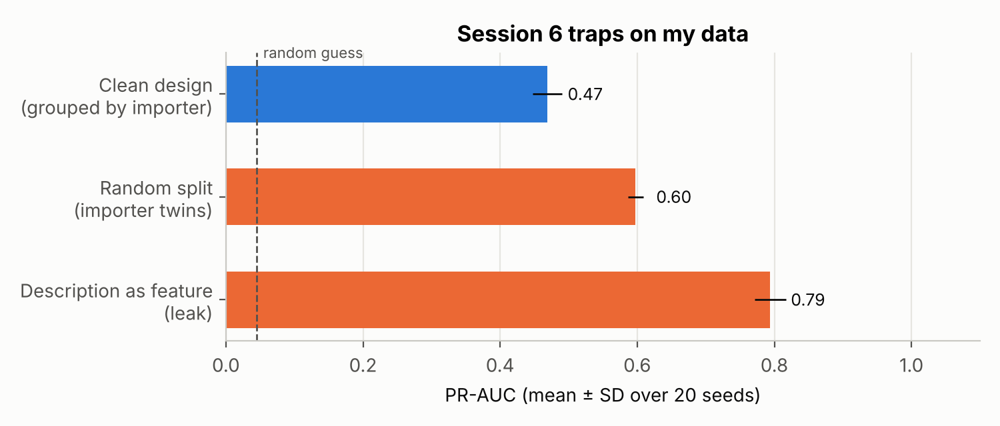
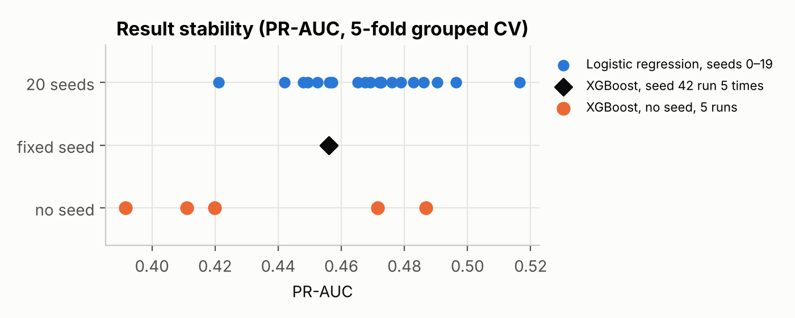

# Reproducibility Audit (Session 6) · Part 1: a published paper · Part 2: my own data

**Thesis:** Sustainable Import Patterns of Tissue Parent Rolls in Peru (2020–2025): A Machine Learning Analysis of Customs Import Records
**Author:** Angela Milén Acosta Ticona · Doctoral Program in Deep Tech, AI & Emerging Technologies, UNMSM · Course: Research Methods & Scientific Integrity in AI (Dr. Loveleen Gaur)

**EN:** In Part 1 I audited a published paper (DATE, Kim et al., KDD 2020: https://github.com/angelaacosta-byte/date-repro-audit). Here I apply the same audit to **my own data and pipeline**: data versions, data quality, reproducible cleaning, anomaly stability, 20-seed stability, the seeded vs unseeded test, the Session 6 labs (leakage, twins, effect sizes) and the Session 6 scorecard.
**ES:** En la Parte 1 audité un artículo publicado (DATE). Aquí aplico la misma auditoría a **mis propios datos**.

## Part 1 · Audit of a published paper (Session 6 deliverable)
| File | Content |
|---|---|
| `Part1_DATE_Reproducibility_Audit_Report.pdf` | Report on DATE (Kim et al., KDD 2020): paper metadata, experimental setup, leakage check, statistical rigor, re-execution, missing information, scorecard and top-3 recommendations |
| `Part1_Session6_Labs_Your_Turn.ipynb` | The six Session 6 labs with my "Your turn" answers |
| Code and logs | https://github.com/angelaacosta-byte/date-repro-audit |

**Part 1 verdict:** 7 / 18 (39%), partially reproducible: no seeds (Precision@1% from 15.8% to 34.7% across unseeded runs), unpinned environment, no statistical test for the model comparison.

## Part 2 · The same audit on my own data

## Main findings · Hallazgos principales

| Check | Result |
|---|---|
| Data versions fingerprinted (MD5) | raw 11,586 → prefiltered 3,748 → final 2,994 records; all three hashes verified |
| Data quality (raw → final) | no duplicates, no invalid dates or HS codes; supplier missing in 27% (raw) and 48% (final) of records → supplier identity is not used as a predictor |
| Cleaning re-run from code | reproduces the final file **record by record** (2,968 kept by rules + 26 by documented expert decision) |
| Anomaly screen, 20 seeds | 59–60 records flagged per seed; mean Jaccard 0.76 → only the **39 records flagged by all 20 seeds** are treated as anomalies |
| Main model, 20 seeds | PR-AUC **0.4686 ± 0.0212** (base rate 0.0444), identical to the public repository `repro-lab-roll-paper` |
| Import profiles, 20 seeds | K-Means k = 6, adjusted Rand index 0.97 → very stable |
| Seeded vs unseeded (DATE lesson) | seed 42 run 5 times → identical; no seed → PR-AUC varies between runs |
| Session 6 Lab 2 (leakage) on my data | using the description as a feature inflates PR-AUC from 0.47 to 0.79 → the description is excluded |
| Session 6 Lab 3 (twins) on my data | a random split lets the same importer into train and test and inflates PR-AUC to 0.60 → I split by importer |
| Session 6 Lab 5 (effect size + CI) | recycled vs virgin price −15% [−17%, −12%], Cohen's d −0.68; H5 −0.7 pts [−2.4, +1.1], Cohen's h −0.03 → no detectable change |
| Session 6 scorecard on my own work | **7.5 / 9 = 15 / 18 (83%)** on the same scale used for DATE (7 / 18): Yes on 6 items, Partial on tuning, external validation and data availability |

## Files
| File | Content |
|---|---|
| `D6_Data_Quality_and_Reproducibility_Audit.ipynb` / `.html` | The audit, executed |
| `limpieza_reglas.py`, `decisiones_manuales.csv` | Cleaning rules and documented expert decisions (no firm names) |
| `figures/`, `outputs/` | Figures and tables produced by the notebook |

## Data
The three Veritrade files are commercially sensitive and are **not** published here. Their MD5 fingerprints are listed in Section 1 of the notebook; the anonymised feature table is public in https://github.com/angelaacosta-byte/repro-lab-roll-paper.

## Reproduce
Put `01_raw_veritrade.xlsx`, `02_prefiltered.xlsx` and `03_final_bobinas.xlsx` in `data/`, then `pip install -r requirements.txt` and *Run All*. Section 6 gives different numbers on every run **on purpose** (it shows what happens without a seed).
