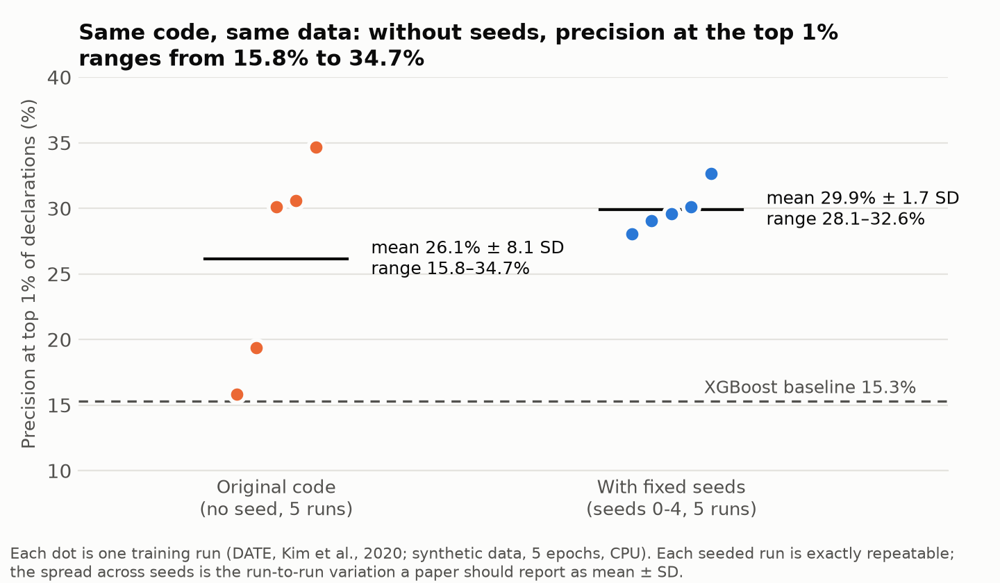

> **Copy of** [github.com/angelaacosta-byte/date-repro-audit](https://github.com/angelaacosta-byte/date-repro-audit) (commit `572de29`, 16 October 2026), placed here so all course deliverables are in one repository. The audit report itself (PDF) and my Session 6 lab notebook are in the parent folder, `DELIVERABLE N°6`.
>
> **ES:** Copia del repositorio original, para tener todos los entregables del curso en un solo lugar. El informe de auditoría (PDF) y mi notebook de la Sesión 6 están en la carpeta superior, `DELIVERABLE N°6`.

# Reproducibility audit of DATE (Kim et al., KDD 2020)

Evidence for the **Reproducibility Audit Report** prepared for *Research Methods & Scientific Integrity in AI*, Session 6
(Doctoral Program in Deep Tech, AI & Emerging Technologies, UNMSM · Dr. Loveleen Gaur).

Author: Angela Milén Acosta Ticona · October 2026

**Paper audited:** Kim, S., Tsai, Y.-C., Singh, K., Choi, Y., Ibok, E., Li, C.-T., & Cha, M. (2020). DATE: Dual attentive tree-aware embedding for customs fraud detection. *KDD '20*, 2880–2890. https://doi.org/10.1145/3394486.3403339
**Repository audited:** https://github.com/Roytsai27/Dual-Attentive-Tree-aware-Embedding, commit `5c540d6` (18 July 2021).
This repository contains **no copy of the authors' code**: only three small patches, the scripts that re-run the audit, and the logs it produced.

## Main findings

| Check | Result | Evidence |
|---|---|---|
| Runs as released with current libraries? | **No**: fails twice (pandas ≥ 2.0, PyTorch ≥ 2.6) | `failure1_pandas_weekofyear.txt`, `failure2_torch_load.txt` |
| Runs in a 2020-era environment? | **Yes**, unchanged (Python 3.8.20, PyTorch 1.4.0, pandas 1.0.5) | `env2020_step*.txt`, `requirements-2020-lock.txt` |
| Same result across library versions? | **No**: the deterministic XGBoost baseline gives AUC 0.730 (2020 libraries) vs 0.723 (current) | `env2020_step2_baselines.txt` vs `step2_baselines.txt` |
| Same result when re-run without seeds? | **No**: Precision@1% from 15.8% to 34.7% over 5 runs (26.1% ± 8.1 SD) | `unseeded_run1-5.txt` |
| Same result when re-run with a fixed seed? | **Yes**: seed 0 run twice gives identical metrics | `seeded_seed0.txt`, `seed0_repeat.txt` |
| Spread across fixed seeds 0–4 | Precision@1% 28.1% to 32.6% (29.9% ± 1.7 SD) | `seeded_seed0-4.txt` |



## Files

| File | What it is |
|---|---|
| `01_fix_pandas_weekofyear.patch` | Replaces `dt.weekofyear` (removed in pandas 2.0) with `dt.isocalendar().week` |
| `02_fix_torch_load.patch` | Adds `weights_only=False` to `torch.load` (default changed in PyTorch 2.6) |
| `03_add_seed_option.patch` | Adds an optional `--seed` argument that seeds Python, NumPy and PyTorch; without it, behaviour is unchanged |
| `run_audit.sh` | Clones the audited commit, applies the patches and re-runs every experiment |
| `summarize_runs.py` | Reads the training logs and writes `runs_summary.csv` (one row per run, then mean ± SD) |
| `make_figure.py` | Draws `fig_precision_runs.png` from `runs_summary.csv` |
| `requirements-audit-lock.txt` | Exact environment of the audit runs (Python 3.12.3, CPU only) |
| `requirements-2020-lock.txt` | Exact 2020-era environment of the comparison run |
| `*.txt` logs | Raw output of every step and run |

## How to reproduce

```bash
git clone https://github.com/angelaacosta-byte/date-repro-audit.git && cd date-repro-audit
pip install -r requirements-audit-lock.txt
pip install git+https://github.com/lessw2020/Ranger-Deep-Learning-Optimizer@c82a304
bash run_audit.sh                     # about 35 minutes on 2 CPU cores; writes logs to work/logs
python summarize_runs.py .            # summary of the logs stored here
python make_figure.py                 # regenerates the figure
```

Expected: `step2_baselines.txt` shows XGBoost `AUC = 0.7225`; seed 0 gave `Pr@1:0.2908` on every run on the audit machine (other CPUs may differ slightly, but repeated runs on one machine must match).
Unseeded runs will differ from the stored logs each time; that is the finding.

## Limits of this audit

- The real Nigerian data are under a non-disclosure agreement, so the paper's numbers (for example 92.7% Precision@1%) **cannot** be checked. All runs use the bundled synthetic file (100,000 declarations, 2013).
- Python 3.7, which the authors used, was not available; the 2020-era run used Python 3.8.20.
- Five runs per condition is a small sample; the difference in spread between the unseeded and seeded groups is not a claim that seeding reduces variance.

## Licence

Scripts and patches in this repository: MIT. The audited DATE code remains under its authors' CC BY-NC-SA 4.0 licence and is not redistributed here.
